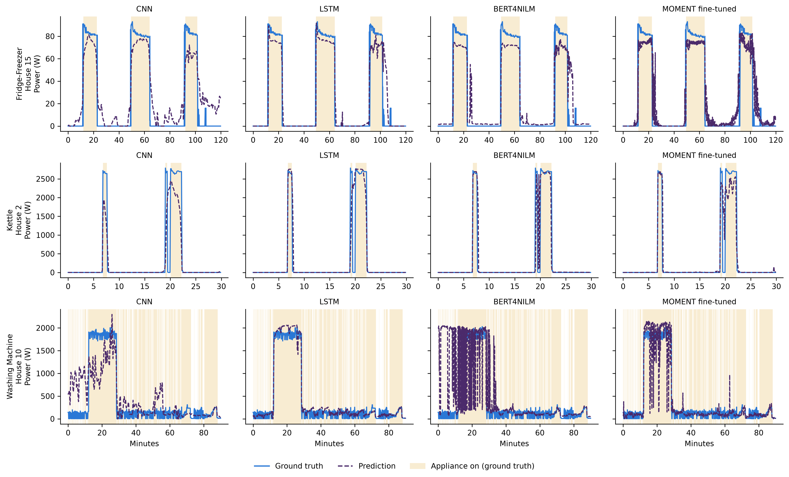
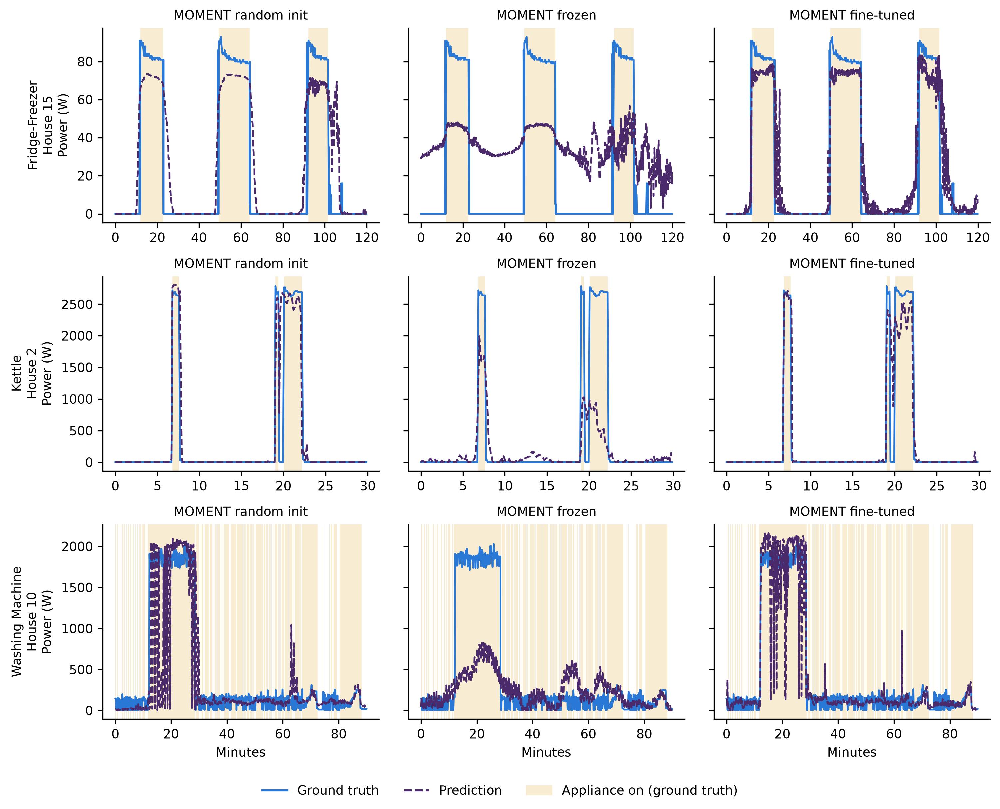

# Evidence Record

Baselines, architectures, tuned configurations, training protocol and results for [README.md](README.md).

## Baselines and ablations

### Sanity baselines

Zero and median predictors (`runs/zero`, `runs/median`) give a floor that the trained models should beat.

| Model | Purpose |
|---|---|
| CNN | Convolutional baseline |
| LSTM | Recurrent baseline |
| BERT4NILM | NILM-specific Transformer baseline |
| MOMENT-small (random init) | To measure architectural gains |
| MOMENT-small (frozen) | To measure frozen feature gains |
| MOMENT-small (full fine-tuning) | To measure NILM adaptation gains |

## Architectures

### CNN (Zhang et al., [AAAI 2018](https://doi.org/10.1609/aaai.v32i1.11873))

[src/models/cnn.py](src/models/cnn.py)

```
Input [B, 512]
→ Conv1d(1→30, k=10) → ReLU
→ Conv1d(30→30, k=8) → ReLU
→ Conv1d(30→40, k=6) → ReLU
→ Conv1d(40→50, k=5) → ReLU
→ Conv1d(50→50, k=5) → ReLU
→ Flatten → Linear(→1024) → ReLU → Dropout → Linear(1024→1)
```

### LSTM (Kelly & Knottenbelt, [BuildSys 2015](https://doi.org/10.1145/2821650.2821672))

[src/models/lstm.py](src/models/lstm.py)

```
Input [B, 512]
→ Conv1d(1→16, k=4, length-preserving padding)
→ BiLSTM(hidden h1) → BiLSTM(hidden h2)
→ hidden state at the window midpoint
→ Linear(2·h2→128) → Tanh → Linear(128→1)
```

Default hidden sizes are (h1, h2) = (128, 256).

### BERT4NILM (Yue et al., [NILM 2020](https://doi.org/10.1145/3427771.3429390))

[src/models/bert4nilm.py](src/models/bert4nilm.py)

```
Input [B, 512]
→ Conv1d(1→256, k=5, replicate padding) → LPPool1d(p=2, ↓2) → [B, 256, 256]
→ + learned positional embedding → LayerNorm → Dropout
→ 2 × Transformer block (post-LN, 2 heads, FFN 1024, GELU)
→ ConvTranspose1d(256→256, k=4, s=2) → [B, 512, 256]
→ hidden state at the window midpoint
→ Linear(256→128) → Tanh → Linear(128→1)
```

Trained seq2point with MSE, not the paper's masked multi-term loss.

### MOMENT-small (Goswami et al., [ICML 2024](https://proceedings.mlr.press/v235/goswami24a.html))

[src/models/moment.py](src/models/moment.py)

```
Input [B, 512]
→ Patching (64 patches × 8 points) → patch embedding
→ T5 encoder (8 layers, 6 heads, d_model 512, FFN 1024, gated GELU)  [AutonLab/MOMENT-1-small]
→ Flatten [B, 64·512] → Dropout → Linear(32768→1)
```

RevIN is turned off, so the encoder sees the same dataset-normalized input as the other models.

## Tuned configurations

### CNN

| Parameter | Value |
|---|---|
| Conv channels | 30, 30, 40, 50, 50 |
| Kernel sizes | 10, 8, 6, 5, 5 |
| Strides | 1, 1, 1, 1, 1 |
| Dense units | 1024 |
| Dropout | 0.1 |
| Batch size | 512 |
| Learning rate | 3e-4 |
| Weight decay | 0.0 |
| Max windows per house | 100,000 |


### LSTM

| Parameter | Value |
|---|---|
| Conv1D filters / kernel size | 16 / 4 |
| BiLSTM hidden units | 128, 256 |
| Fully connected units | 128 (tanh) |
| Optimizer | Adam, no weight decay |
| Learning rate | 5e-4 |
| Batch size | 256 |
| Gradient clipping (max norm) | 1.0 |
| Loss | MSE (normalized target) |
| Max epochs / patience | 100 / 8 |
| Max windows per house | 100,000 |
| Parameters | 1.27 M |

### BERT4NILM

| Parameter | Value |
|---|---|
| Hidden size / attention heads | 256 / 2 |
| Transformer layers | 2 |
| Feed-forward size | 1024 |
| Dropout | 0.1 |
| Conv kernel size / downsample factor | 5 / 2 |
| Decoder kernel size / stride | 4 / 2 |
| Dense units | 128 (tanh) |
| Optimizer | Adam, no weight decay |
| Learning rate | 5e-5 |
| Batch size | 128 |
| Gradient clipping (max norm) | 1.0 |
| Loss | MSE (normalized target) |
| Max epochs / patience | 100 / 8 |
| Max windows per house | 100,000 |

### MOMENT-small

| Parameter | Value |
|---|---|
| Checkpoint | AutonLab/MOMENT-1-small |
| Head dropout | 0.0 |
| Optimizer | Adam, no weight decay |
| Learning rate (random init / frozen / full fine-tuning) | 1e-5 / 1e-4 / 3e-5 |
| Batch size | 128 |
| Precision | fp32 |
| Gradient clipping (max norm) | 1.0 |
| Loss | MSE (normalized target) |
| Max epochs / patience | 100 / 8 |
| Max windows per house | 100,000 |


## Training protocol

- Up to 100 epochs, early stopping on validation loss (patience 8), Adam, MSE loss.
- Each epoch samples up to `max_windows_per_file` windows per house and shuffles houses together, so large houses don't dominate.
- Hyperparameters are chosen by grid search on a reduced budget (50 epochs, 30,000 windows per house), then the best setting is retrained with the full budget.
- Metrics: MAE and SAE.
- Experiments are tracked in Weights & Biases.

## Results

FF = Fridge-Freezer, K = Kettle, WM = Washing Machine.

### Sanity baselines (MAE)

| Baseline | FF | K | WM |
|---|---|---|---|
| Zero prediction | 24.274 | 17.447 | 18.577 |
| Median prediction | 26.122 | 17.447 | 18.577 |

### Model comparison (mean ± std, seeds 42–46)

| Model | FF MAE | FF SAE | K MAE | K SAE | WM MAE | WM SAE |
|---|---|---|---|---|---|---|
| CNN | 20.68 ± 0.56 | 0.468 ± 0.072 | 6.88 ± 0.72 | 0.050 ± 0.030 | 14.01 ± 0.59 | 0.069 ± 0.047 |
| LSTM | 19.53 ± 7.75 | 0.460 ± 0.158 | 6.20 ± 0.71 | 0.018 ± 0.005 | 12.70 ± 1.85 | 0.125 ± 0.093 |
| BERT4NILM | 16.16 ± 1.21 | 0.354 ± 0.065 | 5.46 ± 0.61 | 0.086 ± 0.035 | 11.65 ± 0.84 | 0.081 ± 0.070 |
| MOMENT-small (random init) | 17.02 ± 1.72 | 0.312 ± 0.114 | 8.38 ± 3.62 | 0.146 ± 0.138 | 19.58 ± 2.21 | 0.242 ± 0.105 |
| MOMENT-small (frozen) | 36.78 ± 1.90 | 0.868 ± 0.133 | 18.17 ± 1.11 | 0.286 ± 0.080 | 28.54 ± 1.84 | 0.535 ± 0.103 |
| MOMENT-small (full fine-tuning) | 14.45 ± 0.66 | 0.301 ± 0.058 | 5.80 ± 0.17 | 0.033 ± 0.026 | 11.96 ± 0.56 | 0.120 ± 0.029 |


Baselines vs MOMENT-small (full fine-tuning):



MOMENT-small ablations:


